<!-- ============ HEADER ============ -->

  

  

  
  
  
  
  
   
  
  
  
  
  

 

<!-- ============ NOW ============ -->
##  Currently building

> **[StylusForge](https://github.com/wkalidev/stylusforge)** — an interactive IDE to learn Arbitrum Stylus smart contracts in Rust, with on-chain completion certificates.

 

<!-- ============ PROJECTS ============ -->
##  Live projects

  <a href="https://celobank-agent.vercel.app"></a>
  <a href="https://trivia-quest-eight.vercel.app"></a>

  <a href="https://celosave-two.vercel.app"></a>
  <a href="https://volvic.wkalidev.com"></a>

  <a href="https://base2stacks-tracker.vercel.app"></a>
  <a href="https://stacks-quest-ten.vercel.app"></a>

  <a href="https://dailydrop-five.vercel.app"></a>
  <a href="https://chainwarden.vercel.app"></a>

  <a href="https://multichain-mcp.vercel.app"></a>
  <a href="https://multichain-tax-mcp.vercel.app"></a>

 

<!-- ============ TOOLING ============ -->
##  Open-source tooling & SDKs

| Project | What it does | npm |
|---|---|---|
| [unlock-mcp](https://github.com/wkalidev/unlock-mcp) | Read-only MCP server to check Unlock Protocol memberships on-chain | — |
| [`@celobank/agent-sdk`](https://www.npmjs.com/package/@celobank/agent-sdk) | CeloBank Agent TypeScript SDK |  |
| [`@wkalidev/trivia-quest-sdk`](https://www.npmjs.com/package/@wkalidev/trivia-quest-sdk) | TriviaQ smart contracts SDK |  |
| [`@wkalidev/stacks-quest-sdk`](https://www.npmjs.com/package/@wkalidev/stacks-quest-sdk) | Stacks Quest multichain SDK |  |
| [`@wkalidev/b2s-contracts`](https://www.npmjs.com/package/@wkalidev/b2s-contracts) | $B2S contracts & TypeScript SDK |  |
| [`@wkalidev/stacks-clarity-toolkit`](https://www.npmjs.com/package/@wkalidev/stacks-clarity-toolkit) | Clarity utilities used in mainnet contracts |  |

 

<!-- ============ STACK ============ -->
##  Stack

  

  
  
  
  

  
  
  
  

 

<!-- ============ CONTENT ============ -->
##  Content

  

  
  
  
  
  

 

<!-- ============ 3D CONTRIBUTIONS ============ -->
##  Contributions in 3D

  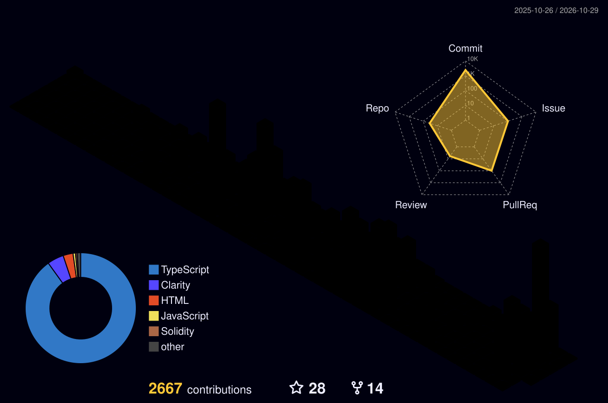

 

<!-- ============ RECOGNITION ============ -->
##  Recognition

  

  

 

<!-- ============ HIRE ============ -->
##  Work with me

<b>I build production dApps end to end — from architecture to deployment.</b>

  

 

  
  &nbsp;
  
  &nbsp;
  
  &nbsp;
  

  <a href="https://about.wkalidev.com/media-kit">Media kit</a> · <a href="https://about.wkalidev.com/terms">Terms of service</a>

 

  
  
  
  

